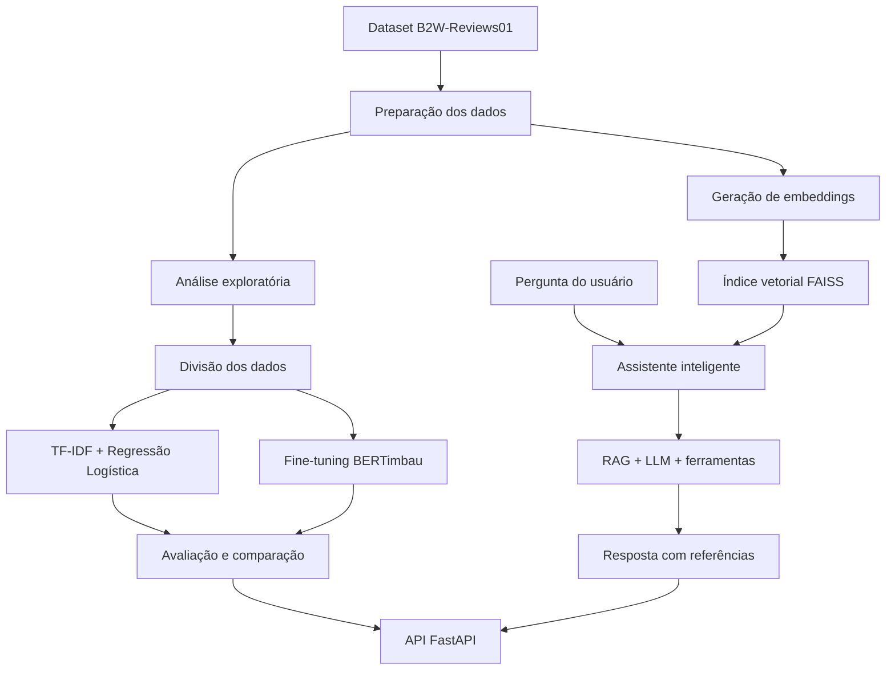

# ReviewLens
### Análise inteligente de avaliações de clientes com Machine Learning e Inteligência Artificial Generativa

O **ReviewLens** é um projeto de Inteligência Artificial desenvolvido para transformar avaliações de clientes em português em informações úteis para análise e tomada de decisão.

A solução combina Processamento de Linguagem Natural (PLN), Machine Learning clássico, fine-tuning de modelos Transformer, busca semântica e Retrieval-Augmented Generation (RAG) para identificar padrões de opinião e responder perguntas sobre a experiência dos consumidores.

**Status:** Em desenvolvimento.

---

## 1. Visão geral

O ReviewLens possui duas funcionalidades principais:

### Análise de sentimentos

Classificação automática de avaliações em três categorias:

- Negativo;
- Neutro;
- Positivo.

Serão implementadas e comparadas duas abordagens:

- **Baseline:** TF-IDF combinado com Regressão Logística.
- **Modelo ajustado:** BERTimbau com fine-tuning para classificação de sentimentos em avaliações de produtos em português.

A comparação será realizada sobre o mesmo conjunto de teste, utilizando o F1-score macro como métrica principal.

### Assistente conversacional de avaliações

Um assistente capaz de responder perguntas em linguagem natural sobre as experiências relatadas pelos consumidores.

Exemplos de perguntas:

- Quais são as principais reclamações sobre entrega?
- O que os consumidores dizem sobre a qualidade dos produtos?
- Quais são os motivos mais frequentes das avaliações negativas?
- Quais categorias apresentam maior concentração de avaliações negativas?

Para isso, será utilizada uma arquitetura de Retrieval-Augmented Generation (RAG), combinando embeddings, busca semântica e um modelo de linguagem.

As respostas deverão apresentar referências às avaliações recuperadas, permitindo identificar as fontes utilizadas na geração das respostas.

---

## 2. Arquitetura proposta

O projeto contempla um pipeline completo, desde o processamento dos dados até a disponibilização dos modelos por meio de uma API REST.



---

## 3. Tecnologias

| Área | Tecnologias |
|---|---|
| Linguagem | Python |
| Manipulação de dados | Pandas, NumPy |
| Machine Learning | Scikit-learn |
| Processamento de Linguagem Natural | Hugging Face Transformers |
| Modelo de linguagem | BERTimbau |
| Embeddings | Sentence Transformers |
| Busca vetorial | FAISS |
| Inteligência Artificial Generativa | Gemini API |
| Arquitetura de recuperação | RAG |
| Orquestração de ferramentas | Tool Calling |
| API REST | FastAPI |
| Testes automatizados | Pytest |
| Qualidade de código | Ruff |
| Integração contínua | GitHub Actions |
| Containerização | Docker |

---

## 4. Base de dados

O projeto utilizará o **B2W-Reviews01**, um conjunto de dados aberto com mais de 130 mil avaliações de consumidores da Americanas.com, coletadas entre janeiro e maio de 2018.

Entre os principais atributos disponíveis estão:

| Atributo | Descrição |
|---|---|
| `overall_rating` | Nota atribuída pelo consumidor, de 1 a 5 |
| `recommend_to_a_friend` | Indicação de recomendação do produto |
| `review_title` | Título da avaliação |
| `review_text` | Texto da avaliação |
| `site_category_lv1` | Categoria do produto |

**Referência bibliográfica:**

REAL, E.; OSHIRO, M.; MAFRA, S. (2019). *B2W-reviews01: an open product reviews corpus*. STIL.

Licença: Creative Commons Attribution 4.0 International (CC BY 4.0).

---

## 5. Avaliação dos modelos

A avaliação será dividida em duas frentes.

### Classificação de sentimentos

- F1-score macro;
- Precisão e revocação por classe;
- Matriz de confusão;
- Análise de erros;
- Comparação entre o baseline e o BERTimbau ajustado.

### Sistema RAG

- Relevância dos documentos recuperados;
- Fidelidade das respostas às avaliações utilizadas;
- Correção das referências apresentadas;
- Comportamento diante de perguntas sem evidências suficientes;
- Funcionamento do mecanismo de fallback.

Os resultados serão documentados após a execução e validação dos experimentos.

---

## 6. Engenharia e confiabilidade

Além da implementação dos modelos, o ReviewLens busca contemplar práticas de engenharia de software aplicadas a sistemas de Inteligência Artificial.

Entre elas:

- Desenvolvimento de API REST com FastAPI;
- Testes automatizados e independentes de serviços externos;
- Validação de entradas e tratamento de exceções;
- Gerenciamento seguro de variáveis de ambiente;
- Mecanismo de fallback local para indisponibilidade do LLM;
- Containerização com Docker;
- Verificação automatizada de código com GitHub Actions.

---

## 7. Estrutura do projeto

A organização seguirá uma arquitetura modular, separando as responsabilidades de processamento de dados, modelagem, recuperação de informações e disponibilização dos serviços.

```text
reviewlens/
├── data/
├── src/
│   └── reviewlens/
│       ├── data/
│       ├── baseline/
│       ├── finetune/
│       ├── embeddings/
│       ├── retriever/
│       ├── llm/
│       ├── tools/
│       ├── assistant/
│       ├── evaluation/
│       └── api/
├── tests/
├── eval/
├── docs/
├── reports/
├── .github/
│   └── workflows/
├── .env.example
├── .gitignore
├── Dockerfile
├── pyproject.toml
└── README.md
```

---

## 8. Limitações conhecidas

Algumas limitações da base de dados e das abordagens utilizadas serão consideradas durante o desenvolvimento:

- Os dados representam avaliações de uma única plataforma de comércio eletrônico.
- As avaliações foram coletadas em 2018, não representando necessariamente o comportamento atual dos consumidores.
- Os rótulos de sentimento derivados das notas podem apresentar ruído, especialmente nas avaliações intermediárias.
- O desbalanceamento entre classes pode afetar o desempenho dos modelos.
- A qualidade das respostas do sistema RAG depende da relevância e da cobertura das avaliações recuperadas.
- Modelos generativos podem produzir interpretações incorretas, mesmo quando recebem documentos de referência.

---

## 9. Roadmap de desenvolvimento

- [ ] Carregamento e análise exploratória dos dados.
- [ ] Definição dos rótulos e preparação da base.
- [ ] Implementação do baseline com TF-IDF e Regressão Logística.
- [ ] Fine-tuning do BERTimbau.
- [ ] Avaliação comparativa e análise de erros.
- [ ] Geração de embeddings e indexação com FAISS.
- [ ] Implementação do assistente conversacional com RAG.
- [ ] Implementação de ferramentas e orquestração.
- [ ] Desenvolvimento dos endpoints com FastAPI.
- [ ] Implementação dos testes automatizados.
- [ ] Configuração do Docker.
- [ ] Configuração da integração contínua.
- [ ] Documentação técnica e publicação dos resultados.

---

## 10. Autoria

**Laysa Cibele**

Estudante de Ciência da Computação e IA. 
- Ciência de Dados, Machine Learning, Processamento de Linguagem Natural e Inteligência Artificial Generativa.

Projeto pessoal desenvolvido com finalidade de aprendizado, experimentação e construção de portfólio técnico.
